<div align="center">


# GCP Yt Rebalance

**Baixe, separe e converta áudio e vídeo: downloads, karaokê, acapella e stems, com processamento 100% local.**

Livre · Gratuito · Offline · Linux, Windows e macOS

[](https://github.com/cliqueprojeto/GCP-Yt-Rebalance/releases/latest)
[](https://github.com/cliqueprojeto/GCP-Yt-Rebalance/releases)
[](LICENSE)


**[⬇️ Baixar](#️-download-e-instalação)** · **[✨ Recursos](#-recursos)** · **[🖼️ Telas](#️-telas)** · **[📜 Versões](CHANGELOG.md)** · **[❤️ Apoie](#️-apoie-o-projeto)**

🇧🇷 Português · [🇺🇸 English](#-english) · [🇪🇸 Español](#-español)

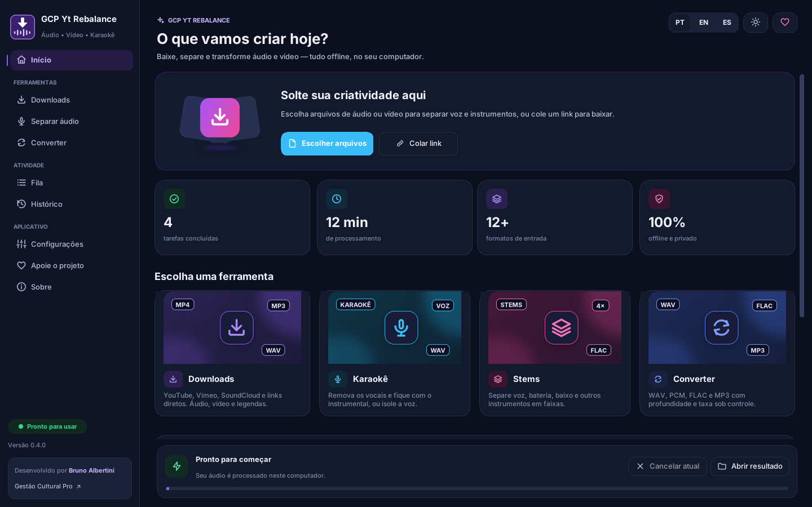

</div>

---

## Sobre

O **GCP Yt Rebalance** faz parte da série de aplicativos **GCP** da [Gestão Cultural Pro](https://www.gestaoculturalpro.com.br). Ele reúne em um só lugar o que normalmente exige vários programas e serviços on-line: baixar áudio e vídeo de links, **remover a voz para karaokê**, **isolar a voz (acapella)**, **separar bateria, baixo e outros instrumentos** e converter o resultado no formato certo.

Tudo acontece **no seu computador**, com um modelo de separação que roda na CPU. Nenhum áudio é enviado para a internet, e não há cadastro, assinatura ou anúncios.

## ✨ Recursos

| | Ferramenta | Saídas | Destaques |
|---|---|---|---|
| ⬇️ | **Downloads** | Áudio (WAV, PCM, FLAC, MP3) · Vídeo com áudio (MP4 ou MKV) | YouTube, Vimeo, SoundCloud, Archive.org e links HTTPS diretos · análise do link com título, duração e resoluções · escolha de vídeo dentro de playlists · resolução de 360p a 2160p |
| 🎤 | **Karaokê** | Instrumental sem voz | Remove os vocais de músicas locais ou direto de um link (**Baixar e remover vocais**) |
| 🗣️ | **Acapella** | Voz isolada | Extrai a voz principal da mixagem |
| 🎚️ | **Voz + instrumental** | 2 faixas | Gera, de uma vez, `Música_Voz` e `Música_Instrumental` |
| 🥁 | **4 stems** | Voz, bateria, baixo e outros | Separação em quatro faixas, para remix, estudo ou ensaio · também direto de um link (**Baixar e separar**) |
| 🔁 | **Converter** | WAV, PCM, FLAC, MP3 | Profundidade de 16, 24 ou 32 bits · 44,1 ou 48 kHz · MP3 de 128 a 320 kbps · PCM bruto com JSON de taxa, bits e canais |
| 💬 | **Legendas** | Arquivos SRT | Lista os idiomas oferecidos pela fonte (publicadas e automáticas), com busca · até 20 idiomas por tarefa, salvos ao lado do resultado |

Entradas aceitas: **WAV, MP3, FLAC, M4A, AAC, OGG, OPUS, MP4, MKV, MOV, WEBM e AVI**.

### Fila e histórico

- **Fila** com uma tarefa ativa por vez (para não travar o computador), progresso em tempo real, estimativa de tempo restante por etapa, pausar após a atual, cancelar, remover e tentar de novo.
- Adicione vários arquivos de uma vez; dá para continuar adicionando enquanto uma tarefa roda.
- **Histórico local** com data, status e botão para abrir a pasta do resultado.
- Cada tarefa cria uma **pasta legível** com nomes claros (ex.: `Música_Voz.wav`, `Música_Instrumental.wav`) e **nunca sobrescreve** resultados anteriores.

### Interface

- Visual premium, coeso com a série GCP: painel inicial com atalhos e estatísticas, ilustrações por ferramenta e ícones vetoriais.
- **Temas escuro, claro ou do sistema**, com troca instantânea pelo botão do topo.
- **Português, inglês e espanhol**, com detecção automática do idioma do sistema (troca rápida pelo seletor PT · EN · ES).
- Preferências de qualidade salvas (formato, bits, taxa, bitrate, resolução e threads de CPU) e restauração dos padrões de fábrica.

### Atualizações automáticas

Novas versões chegam direto das [Releases do GitHub](https://github.com/cliqueprojeto/GCP-Yt-Rebalance/releases). Em **Configurações → Atualizações** você escolhe quando verificar:

> Sempre que abrir o programa · Todos os dias · A cada semana · A cada duas semanas · A cada mês · Nunca

Também dá para **verificar agora** e abrir a **página de versões**. Quando há novidade, aparece o botão **Atualizar para x.y.z** no topo: o aplicativo mostra as notas da versão, baixa o pacote certo para o seu sistema (`.exe`, `.dmg`, `.deb`, `.rpm` ou `.pkg.tar.zst`), **confere o SHA-256** e instala.

## ⬇️ Download e instalação

Baixe o arquivo do seu sistema na [página da última versão](https://github.com/cliqueprojeto/GCP-Yt-Rebalance/releases/latest).

| Sistema | Arquivo | Como instalar |
|---|---|---|
| **Windows 10/11** | `GCP-Yt-Rebalance-x.y.z-Windows-x64-Setup.exe` | Dê dois cliques e avance. O aplicativo instala e abre ao final. |
| **macOS Apple Silicon (M1, M2, M3, M4…)** | `GCP-Yt-Rebalance-x.y.z-macOS-arm64.dmg` | Abra o `.dmg` e arraste o GCP Yt Rebalance para **Aplicativos**. |
| **macOS Intel** | `GCP-Yt-Rebalance-x.y.z-macOS-x86_64.dmg` | Abra o `.dmg` e arraste o GCP Yt Rebalance para **Aplicativos**. |
| **Debian, Ubuntu, Mint, Pop!_OS** | `gcp-yt-rebalance_x.y.z_amd64.deb` | Dê dois cliques e escolha **Instalar**. |
| **Fedora, openSUSE, RHEL** | `gcp-yt-rebalance-x.y.z-1.x86_64.rpm` | Dê dois cliques e escolha **Instalar**. |
| **Arch, BigLinux, Manjaro** | `gcp-yt-rebalance-bin-x.y.z-1-x86_64.pkg.tar.zst` | Dê dois cliques (abre no gerenciador de pacotes) e confirme. |

<details>
<summary><b>Instalar pelo terminal (Linux)</b></summary>

```bash
# Debian / Ubuntu / Mint
sudo apt install ./gcp-yt-rebalance_*_amd64.deb

# Fedora
sudo dnf install ./gcp-yt-rebalance-*.x86_64.rpm

# Arch / BigLinux / Manjaro
sudo pacman -U gcp-yt-rebalance-bin-*-x86_64.pkg.tar.zst
```

Depois, abra pelo menu de aplicativos ou rode `gcp-yt-rebalance`. Em sessões Wayland é usado o XWayland.
</details>

<details>
<summary><b>Avisos de segurança no primeiro uso (Windows e macOS)</b></summary>

O GCP Yt Rebalance ainda não usa certificados pagos de assinatura de código, por isso o sistema pode exibir um aviso na primeira vez:

- **Windows (SmartScreen):** clique em **Mais informações → Executar assim mesmo**.
- **macOS:** clique com o botão direito no app em Aplicativos → **Abrir** → **Abrir** (ou **Ajustes do Sistema → Privacidade e Segurança → Abrir mesmo assim**). Se aparecer "está danificado", rode no Terminal:
  ```bash
  xattr -cr "/Applications/GCP Yt Rebalance.app"
  ```
</details>

<details>
<summary><b>Verificar a integridade do download</b></summary>

Cada arquivo tem um `.sha256` ao lado, e a release traz o `SHA256SUMS.txt`:

```bash
sha256sum -c gcp-yt-rebalance_*_amd64.deb.sha256
```
</details>

### Motores — tudo embutido

**Nada precisa ser instalado.** O instalador já traz:

| Motor | O que faz |
|---|---|
| **HTDemucs + PyTorch (CPU)** | Separação de voz, bateria, baixo e outros instrumentos, com modelo verificado por SHA-256 |
| **FFmpeg e ffprobe** | Leitura de áudio e vídeo, conversão e MP3 (LAME) |
| **yt-dlp + runtime JavaScript** | Downloads e legendas a partir de links |
| **Python embarcado** | Interface e orquestração das tarefas, isoladas do Python do sistema |

Os instaladores são testados automaticamente em máquinas limpas, **sem Python, FFmpeg ou modelo pré-instalados**: Windows, macOS Intel e Apple Silicon, Ubuntu 22.04/24.04, Debian 12/13, Fedora 42 e Arch Linux.

## 🖼️ Telas

| Downloads | Separar áudio |
|---|---|
| 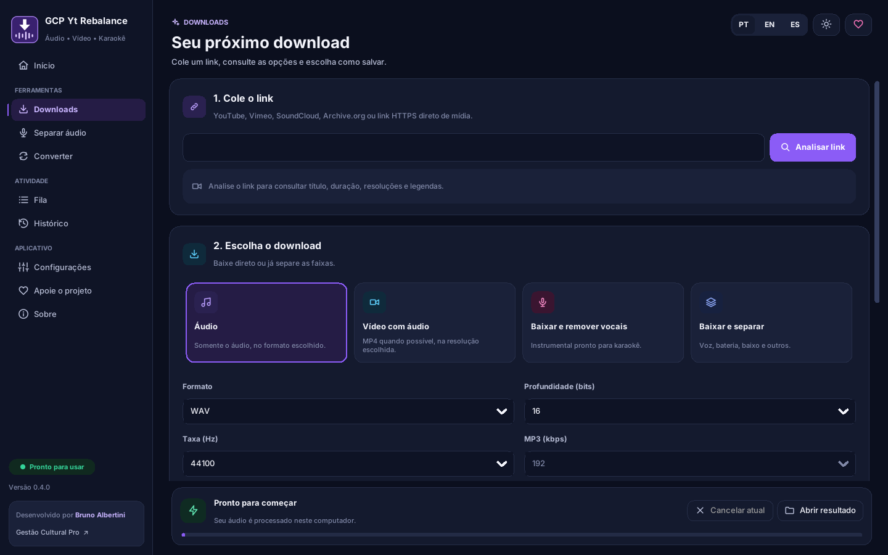 | 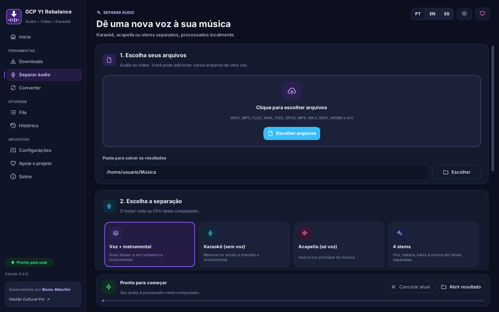 |
| **Converter** | **Fila de tarefas** |
| 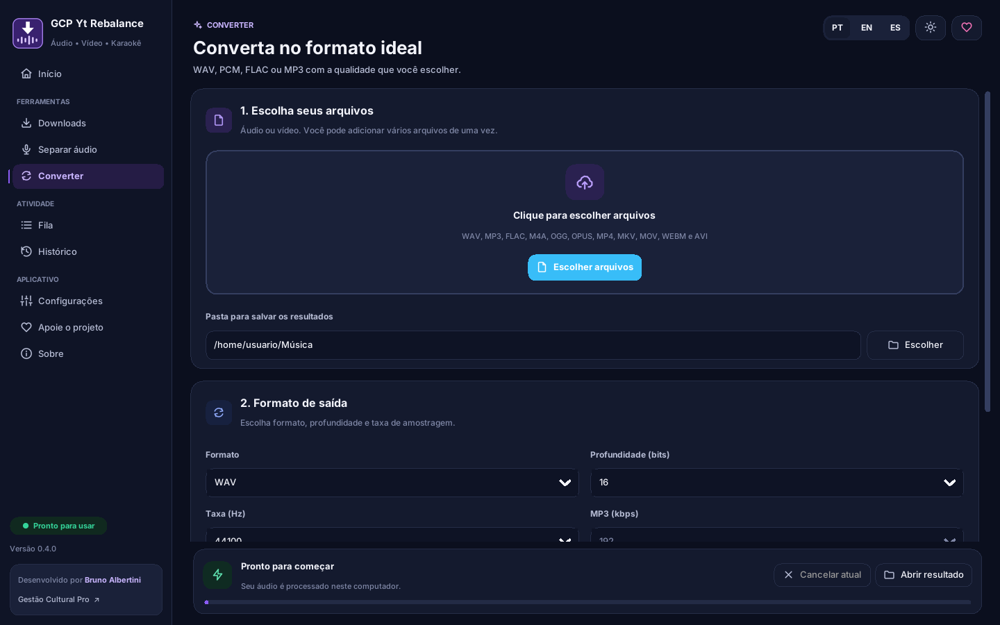 | 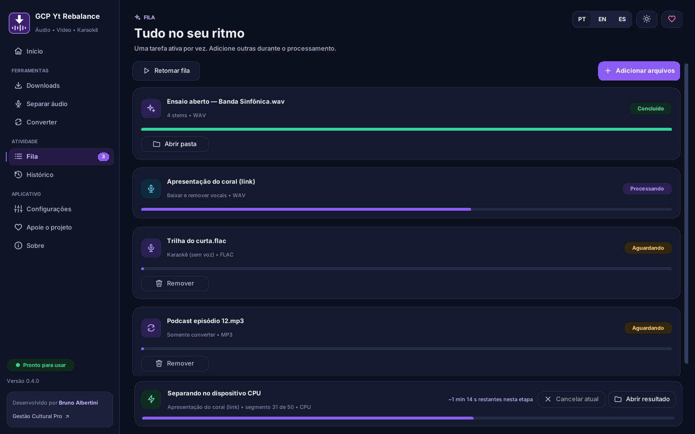 |
| **Histórico** | **Configurações** |
| 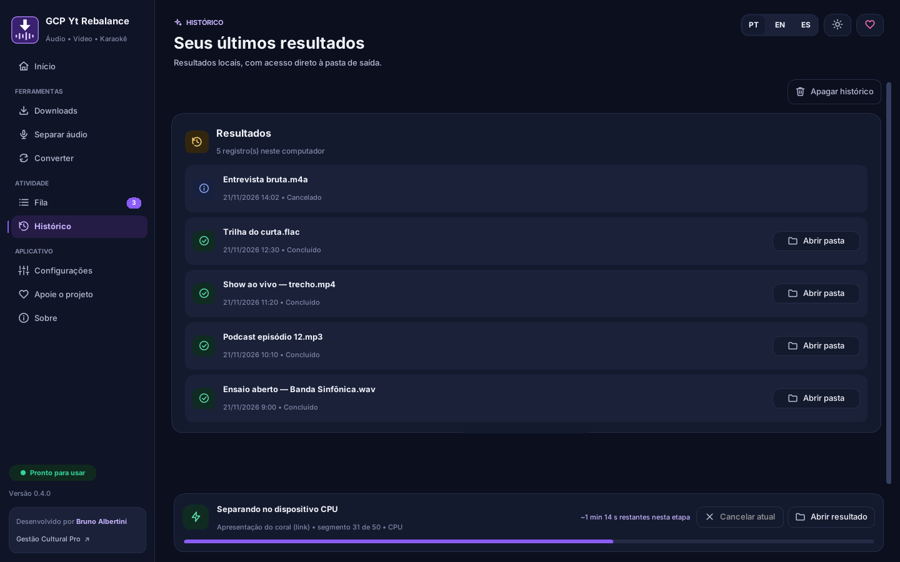 | 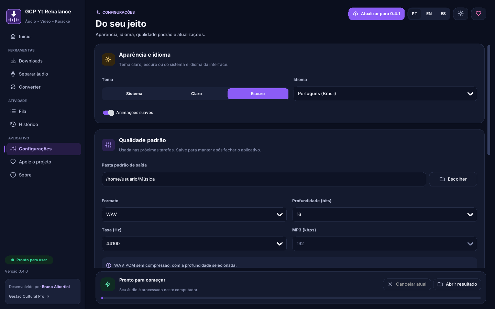 |
| **Atualizações** | **Nova versão disponível** |
| 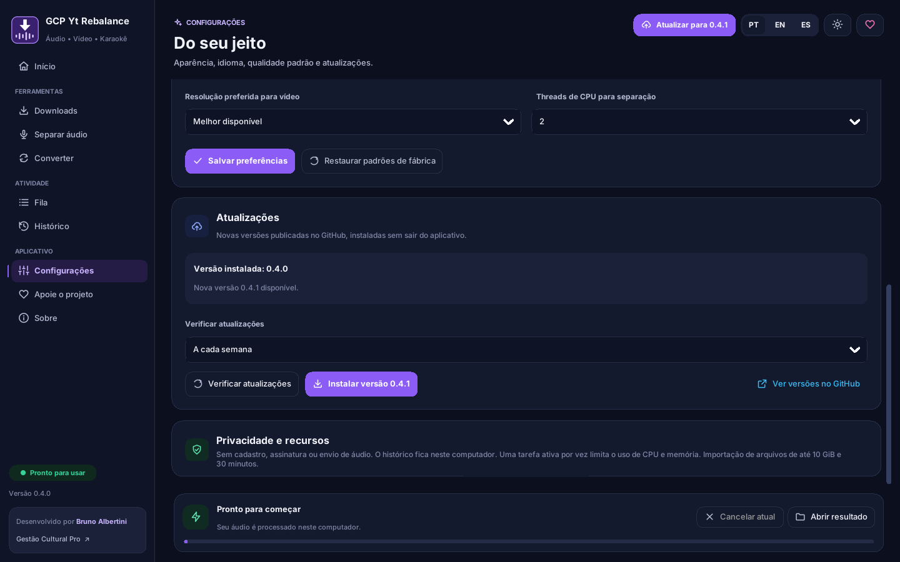 | 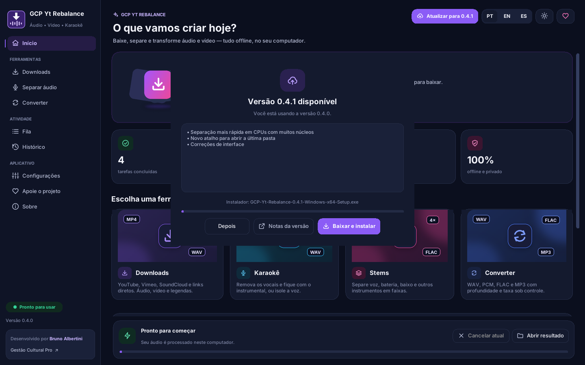 |
| **Apoie o projeto** | **Sobre e licença** |
| 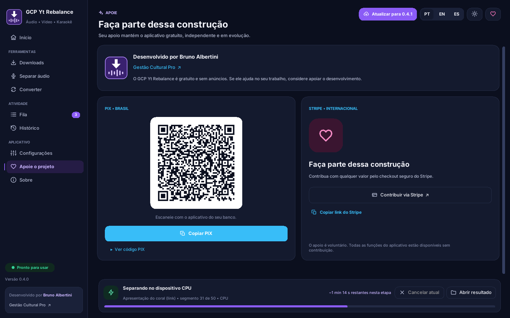 | 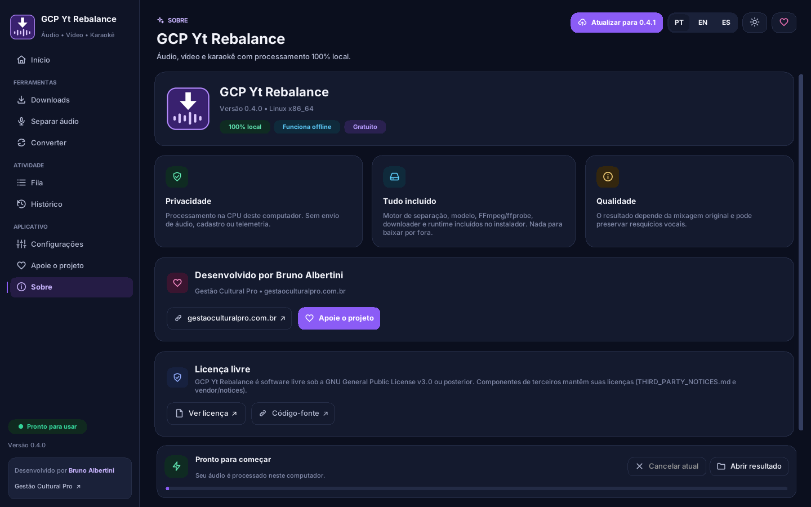 |
| **Tema claro (inglês)** | **Separate audio (light, English)** |
| 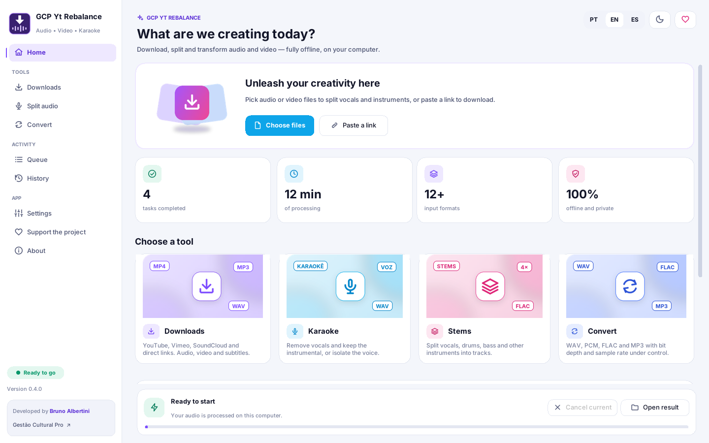 | 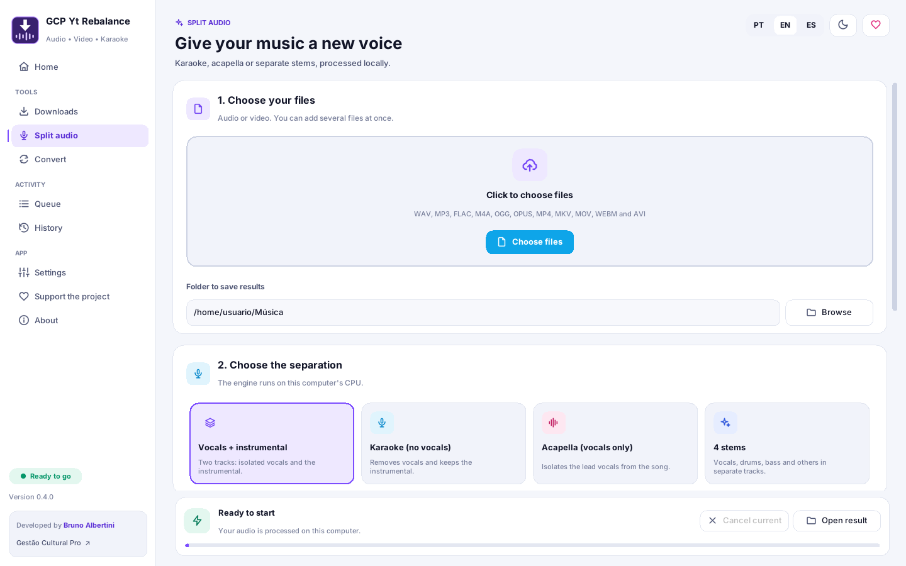 |
| **Apoya el proyecto (español)** | |
| 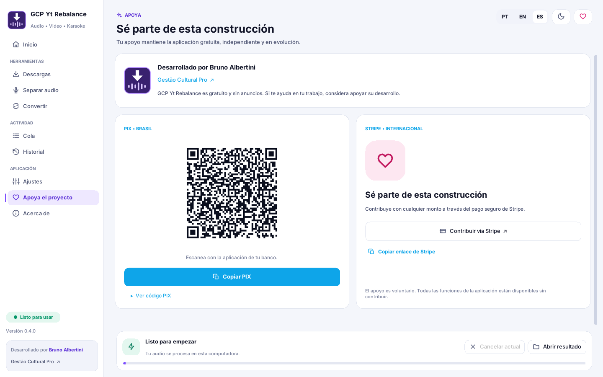 | |

## 📜 Histórico de versões

As notas completas de cada versão estão no [CHANGELOG.md](CHANGELOG.md) e na [página de Releases](https://github.com/cliqueprojeto/GCP-Yt-Rebalance/releases). O aplicativo mostra as notas da nova versão antes de atualizar.

## 🛠️ Desenvolvimento

Requisitos: Python 3.12 com Tk.

```bash
git clone https://github.com/cliqueprojeto/GCP-Yt-Rebalance.git
cd GCP-Yt-Rebalance
python scripts/prepare_ci.py --python --runtime   # dependências fixadas, FFmpeg, yt-dlp e modelo
python apps/desktop/main.py
```

| Comando | O que faz |
|---|---|
| `python apps/desktop/main.py` | Abre o aplicativo |
| `python -m unittest discover -s tests -v` | Testes unitários (traduções, atualizador, empacotamento, contratos) |
| `python apps/desktop/main.py --self-test saida/health.json` | Teste ponta a ponta da interface, idiomas, temas, fila e conversão |
| `python -m PyInstaller apps/desktop/native.spec` | Build nativo macOS/Linux (`windows.spec` no Windows) |
| `python scripts/package_native.py` | Gera `.dmg` (macOS) ou `.deb` + `.rpm` (Linux) |
| `python scripts/support_assets.py` | Recria o QR Code PIX da tela Apoie |

### Publicar uma nova versão

1. Atualize `VERSION` em `apps/desktop/runtime.py`, adicione a seção no `CHANGELOG.md` e crie `docs/release-notes/vX.Y.Z.md`.
2. Envie uma tag `vX.Y.Z` (ou rode o workflow **Release — GCP Yt Rebalance** pela aba Actions).
3. O GitHub Actions compila para Windows, macOS (Intel e Apple Silicon) e Linux, testa cada instalador em máquinas limpas e publica a Release. Os aplicativos já instalados detectam a nova versão sozinhos.

### Estrutura

```
apps/desktop/        aplicativo
  main.py            entrada, worker isolado e self-test
  gui.py             interface (páginas, fila, histórico, apoio e atualizações)
  theme.py           cores claro/escuro e fontes
  i18n.py            traduções (pt-BR, en, es)
  ui_icons.py        ícones vetoriais
  artwork.py         ilustrações geradas localmente
  engine.py          separação e conversão
  download.py        downloads e legendas
  updater.py         atualizações pelas Releases do GitHub
assets/              ícones, fonte Inter e QR Code PIX
packaging/arch/      PKGBUILD
scripts/             build, empacotamento e testes de instalação
tests/               testes unitários
```

## ❤️ Apoie o projeto

O GCP Yt Rebalance é livre e gratuito. Sua contribuição ajuda a mantê-lo aberto e em evolução. Todas as funções estão disponíveis sem contribuição. Também dá para apoiar pelo botão ❤️ dentro do aplicativo.

<table>
<tr>
<td align="center" width="50%">

**PIX · Brasil**


<details><summary>Código PIX copia e cola</summary>

```
00020126850014br.gov.bcb.pix0136e474b71b-7491-4eac-992f-632652e5a4eb0223DEV GESTAO CULTURAL PRO5204000053039865802BR5915BRUNO ALBERTINI6006BRASIL62200516ChromeExtensions63042B27
```
</details>

</td>
<td align="center" width="50%">

**Stripe · Internacional**

Contribua com qualquer valor pelo checkout seguro do Stripe.

**[💜 Contribuir via Stripe](https://donate.stripe.com/fZu4gzeBSfhbd7451F6Ri00)**

</td>
</tr>
</table>

## 📄 Licenças

- **GCP Yt Rebalance:** [GNU General Public License v3.0](LICENSE) ou posterior.
- **Componentes de terceiros** (PyTorch, Demucs/HTDemucs, FFmpeg, LAME, yt-dlp, Node.js, CustomTkinter, Pillow, Inter e outros): veja [THIRD_PARTY_NOTICES.md](THIRD_PARTY_NOTICES.md). Os textos completos acompanham o instalador em `vendor/notices`.

Use somente conteúdo que você tem direito de baixar e processar. As marcas citadas (YouTube, Vimeo, SoundCloud etc.) pertencem aos seus titulares e aparecem apenas como referência de compatibilidade.

---

## 🇺🇸 English

**GCP Yt Rebalance** is a free, offline app to **download, split and convert audio and video**, for Linux, Windows and macOS (Apple Silicon and Intel). Everything runs **on your computer's CPU**: no uploads, no sign-up, no ads.

- **Downloads:** YouTube, Vimeo, SoundCloud, Archive.org and direct HTTPS links · audio or video with audio (MP4/MKV) · 360p to 2160p · playlists · subtitles as SRT.
- **Karaoke:** remove vocals and keep the instrumental, from local files or straight from a link.
- **Acapella** and **vocals + instrumental** in one go.
- **4 stems:** vocals, drums, bass and others.
- **Convert:** WAV, PCM, FLAC, MP3 · 16/24/32-bit · 44.1/48 kHz · 128–320 kbps.
- Queue with live progress and time estimates, local history, readable output folders that never overwrite.
- Dark/light/system themes, Portuguese/English/Spanish with automatic system detection.
- Automatic updates from GitHub Releases (on startup, daily, weekly, every two weeks, monthly or never) with SHA-256 verification.
- Everything bundled: separation model, PyTorch, FFmpeg, yt-dlp and runtime. Nothing else to install.

**Install:** download your file from the [latest release](https://github.com/cliqueprojeto/GCP-Yt-Rebalance/releases/latest) and double-click it (see the table above). Licensed under [GPL-3.0-or-later](LICENSE).

## 🇪🇸 Español

**GCP Yt Rebalance** es una aplicación gratuita y sin conexión para **descargar, separar y convertir audio y video**, para Linux, Windows y macOS (Apple Silicon e Intel). Todo se procesa **en la CPU de tu computadora**: sin envíos, sin registro y sin anuncios.

- **Descargas:** YouTube, Vimeo, SoundCloud, Archive.org y enlaces HTTPS directos · audio o video con audio (MP4/MKV) · de 360p a 2160p · listas de reproducción · subtítulos en SRT.
- **Karaoke:** elimina la voz y conserva el instrumental, desde archivos locales o directo de un enlace.
- **Acapella** y **voz + instrumental** de una sola vez.
- **4 stems:** voz, batería, bajo y otros.
- **Convertir:** WAV, PCM, FLAC, MP3 · 16/24/32 bits · 44,1/48 kHz · 128–320 kbps.
- Cola con progreso en tiempo real y estimación de tiempo, historial local, carpetas legibles que nunca sobrescriben.
- Temas oscuro/claro/del sistema, portugués/inglés/español con detección automática.
- Actualizaciones automáticas desde GitHub Releases con verificación SHA-256.
- Todo incluido: modelo de separación, PyTorch, FFmpeg, yt-dlp y runtime.

**Instalación:** descarga tu archivo en la [última versión](https://github.com/cliqueprojeto/GCP-Yt-Rebalance/releases/latest) y haz doble clic (ver la tabla de arriba). Licencia [GPL-3.0-or-later](LICENSE).

---

<div align="center">

Desenvolvido por **[Bruno Albertini | Gestão Cultural Pro](https://www.gestaoculturalpro.com.br)**

<sub>Série GCP · <a href="https://github.com/cliqueprojeto">github.com/cliqueprojeto</a></sub>

</div>
